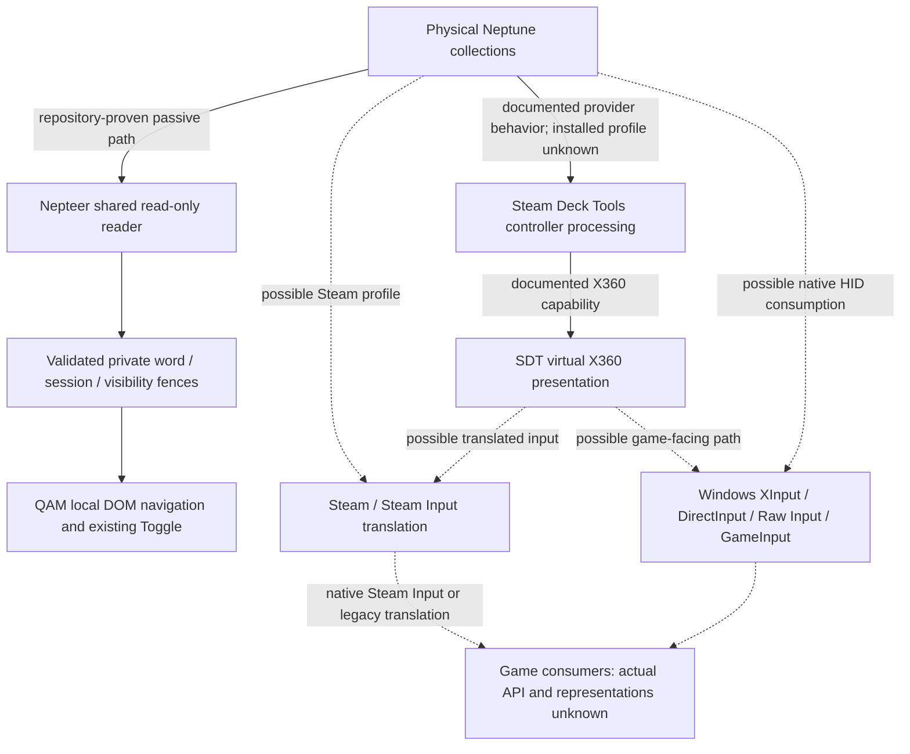

# Step 5D decision: controller input routing

Status: proposed for independent review; research only. Researched 2026-11-23 against main `6f879e542feeee37c95a85615d926e6d5a48d64f` (PR #8). Runtime remains v0.5.0-alpha.2. No input isolation, provider integration or hardware experiment is implemented.

## A. Problem and decision

The user reports that games continue responding to controller buttons while Nepteer's QAM is visible. Step 5C.2 desktop navigation passed user-reported Steam Deck acceptance; that establishes QAM operation, **not exclusive input routing**. We want menu interaction without simultaneous gameplay actions, but cannot promise that with the current observer.

**Recommendation 2: Keep desktop-only navigation and improve non-invasive UX.** Retain physical ⋯ toggle, keyboard/touch/mouse controls and read-only telemetry. Future UX should make the pass-through warning and choice of navigation mode easy to understand. This PR changes documentation only, apart from enabling the research branch in existing CI.

No researched supported API establishes universal isolation across unknown game input paths under Nepteer's present restrictions. A router controlling the actual game-visible output could theoretically filter buttons, but that is a different architecture requiring separate security approval, provider cooperation and crash-safe ownership. Reading Neptune does not confer control of another program's virtual controller.

## B. Repository-proven architecture

The audit covers `neptune/{mod,windows,reports,monitor,correlation,shortcut,navigation}.rs`, `quick_access.rs`, `lib.rs`, QAM/arming React components, generated bindings, capabilities, manifest and bundling configuration at the base above.

- `windows.rs` opens metadata with access zero and input with `GENERIC_READ`, shared READ/WRITE, overlapped bounded reads. Sharing WRITE permits other clients; it does not give Nepteer write access. Cancellation drains outstanding I/O before storage/handles are freed. Private paths remain in memory.
- `mod.rs` serializes one reader owner: diagnostics (five minutes, probe at most thirty seconds) **or** explicitly armed shortcut (thirty minutes). No automatic startup arming, renewal, takeover or reconnect. Stop/disarm is required before switching modes.
- `shortcut.rs` privately classifies exact `deck_v1_zero_prefixed65` reports and shares the same reader between ⋯ and navigation. Reviewed profile: 28DE:1205, interface 2, FFFF/0001, descriptor/actual length 65. Released baselines, report-gap invalidation, cancellation and session fences remain native. ⋯ bit 50 uses its existing 350ms cooldown; navigation has independent edge-only/no-repeat logic.
- `navigation.rs` routes only Previous/Next/Left/Right/Activate/Back to local `quick-access`: four pending offers plus one delivery, generation/epoch/sequence checks and 500ms offer age. Actual native visibility is checked during claim. This fences **Nepteer actions**, not game input.
- `QuickAccess.tsx` moves local DOM focus and invokes existing controls. Up/Down wrap Close, enabled Refresh, Performance, Controller, Display, Settings; A activates, B collapses/closes, Left/Right no-op. No synthetic Windows input is created.
- Main alone manages HID sessions. QAM may claim/complete approved navigation offers, read telemetry and manage its visibility; it cannot arm a reader. CSP/local navigation restrictions remain. Windows manifest is `asInvoker`, `uiAccess=false`; NSIS is current-user. No XInput/GameInput/DirectInput/Steamworks provider integration exists in the audited native code/dependencies.

A granted navigation claim remains a cleanup barrier until trusted completion or destruction of that renderer instance. Unlike unclaimed offers, it cannot simply be discarded on a timer without risking late execution after a successful disarm. A frozen live renderer/broken completion transport can delay native hide/disarm/shutdown acknowledgment; the reader is drained/dropped first. This existing limitation is documented, not changed or presented as an input-isolation lease.

## C. External pipeline and confidence

Solid Nepteer edges are code-proven; solid provider edges describe published capabilities, not a traced installed pipeline. Dotted edges are possibilities. There is deliberately **no QAM-to-game suppression edge**.

Evidence supplied by the user: Deck LCD / Windows 11, SDT X360 manually reported, Steam running, Steam Input unknown; mappings Up8/Down11/Left10/Right9/A7/B5/Steam13/⋯50 reviewed on the scoped collection. These facts do not identify a game's API, virtual slot, provider profile or simultaneous consumers.

SDT documents Desktop, X360 and Steam modes, separate Steam integration profiles, automatic mode changes and double-input concerns. X360 virtual output is therefore plausible, but not proven to be the sole game source. Its documentation lists ViGEmBus as a dependency; the installed version is unknown. No public temporary routing/neutralization contract was found in the SDT controller/shortcut documentation or Steamworks APIs reviewed. This is a bounded search finding, not proof that no future provider API can exist. [SD1][SD2][V1]

The SDT shortcut table describes mode-dependent keyboard/mouse behavior and Steam-button combinations, including Steam+⋯. Nepteer must not suppress, duplicate or reconfigure those actions. User-facing mode selection is contextual consent, not mode detection. Concurrent native/virtual/translated paths can explain duplicate actions; they have not been traced on the reported game. [SD2][SI1][X3]

### Focus is not a universal routing boundary

| Interface                     | Documented scope                                                                                                                                                                                                                                                                                                      | Conclusion for this study                                                                                                                                                                                                                                                           |
| ----------------------------- | --------------------------------------------------------------------------------------------------------------------------------------------------------------------------------------------------------------------------------------------------------------------------------------------------------------------- | ----------------------------------------------------------------------------------------------------------------------------------------------------------------------------------------------------------------------------------------------------------------------------------- |
| XInput                        | `XInputEnable` describes neutral reporting when disabled and application focus handling. Its Windows 10+ note says input is automatically enabled/disabled based on application window focus. DLL versions 1.4, 1.3 and 9.1.0 differ.                                                                                 | Do **not** claim XInput always ignores focus. Conversely, Nepteer cannot use its own reporting flag to neutralize another application's unknown path. Actual focus, consumer API/version and translated/background paths are unresolved. No universal isolation guarantee. [X1][X2] |
| Raw Input / direct HID        | Registration can request foreground delivery or background `INPUTSINK`; `NOLEGACY` concerns the registering application's keyboard/mouse messages. Shared HID reads are a separate path.                                                                                                                              | Registering Nepteer differently does not revoke another consumer's registrations or shared reads. Foreground delivery may stop for a cooperative consumer, background consumers need not. [R1]                                                                                      |
| DirectInput 8                 | Cooperative levels belong to a device instance; foreground acquisition is lost when its window backgrounds, background access is supported.                                                                                                                                                                           | Focus can affect a game's chosen cooperative level. It is not cross-API arbitration. Exclusive acquisition is prohibited here and cannot be assumed to suppress virtual XInput or all nonexclusive consumers. [D1]                                                                  |
| GameInput                     | Current PC default is focused input; v4 permits `EnableBackgroundInput`. Earlier versions use `SetFocusPolicy`. The old exclusive-focus enum was removed in v4. PC sideloading lacks consistent service-managed focus filtering; v4 background enable is ignored, and v1–v3 accepts only default/background policies. | Historical exclusive GameInput flags are not a current universal Windows router. Caller policy cannot establish suppression of XInput/Raw/HID consumers. Nepteer does not currently use GameInput. [G1][G2][G3][G4]                                                                 |
| Tauri/WebView2 / window focus | Foreground activation directs keyboard focus and is OS-restricted. Topmost concerns window presentation, not authority over other applications' controller APIs.                                                                                                                                                      | Existing focus restoration remains best effort. A focused or visible QAM is insufficient evidence that a game stopped polling. Borderless presentation has user evidence; exclusive fullscreen remains unsupported as a guarantee. [F1]                                             |

The report of pass-through is compatible with several paths; it does not contradict every focus-sensitive API or prove a specific reconnect, consumer or game defect. No game/process inspection was performed. In particular, Microsoft documents that a PC sideloaded GameInput runtime may still receive background input depending on the device: its deployment model matters as well as its API version. [G4][G5]

Steam Input's native actions/action sets are part of an integrating title's contract; legacy translation may coexist. Steam overlay callbacks let a participating game choose to pause/resume single-player gameplay. Neither establishes an external arbitrary Tauri overlay's authority to pause or route an unrelated game. No standardized universal pause/neutralize API was identified in these documented surfaces. Cooperative game integration is distinct from suspending a process and may not pause network gameplay. [SI1][SI2][SI3]

## D. Alternatives and feasibility matrices

Conclusion labels: **SD** = Supported by documented capabilities; **PV** = Plausible but unverified; **NE** = Not supported by available evidence; **IA** = Incompatible with current architecture; **SA** = Requires separate security/architecture approval. SD means only the capability stated, never universal game compatibility. Tables split dimensions for readability; A–G identify the same alternatives throughout.

| Option                           | Prevent game actions                                          | XInput games                                     | Raw Input / DirectInput games               | Steam Input                              | SDT coexistence                                                                 | Per-button suppression                                 | Evidence / conclusion                                                                   |
| -------------------------------- | ------------------------------------------------------------- | ------------------------------------------------ | ------------------------------------------- | ---------------------------------------- | ------------------------------------------------------------------------------- | ------------------------------------------------------ | --------------------------------------------------------------------------------------- |
| A Passive observation            | No isolation                                                  | Game path unchanged                              | Game path unchanged                         | Unchanged; may also react                | Current reviewed profile only                                                   | None                                                   | SD for observation; NE for isolation. Repository, X1/R1/D1/G1                           |
| B Cooperative game pause         | Only if game voluntarily honors integration                   | API-independent game cooperation needed          | Same                                        | Steam overlay callback is game-owned     | Does not need to take SDT over                                                  | Game-specific action handling, not universal filtering | SD for documented cooperation; PV for a particular partnership, NE universal. SI3       |
| C Supported provider integration | Conditional on provider controlling every consumed path       | No suitable public routing contract found        | Bypass paths unresolved                     | Per-title API is not cross-title capture | Requires explicit provider-supported contract                                   | Unestablished                                          | NE with reviewed SD1/SD2/SI2; any implementation needs new evidence                     |
| D Controlled virtual output      | Theoretical on output it owns, not other sources              | Plausible virtual X360 path                      | Device support/bypass paths need validation | Duplicate translation/slots possible     | Competes with existing virtual output unless provider cooperates                | Theoretical at authoritative output writer             | PV concept, IA now, SA implementation. V1/X3                                            |
| E Device visibility filtering    | Whole-device access restriction, not selective neutralization | Depends on which game-visible device is hidden   | Depends on selected device and consumer     | May hide a required source               | Hiding physical input can deprive SDT unless allowed; virtual output can remain | No documented per-button filter                        | SD for whole-device visibility, IA/SA here; NE as stand-alone selective solution. H1/H2 |
| F Global interception            | No universal documented hook across all controller paths      | Ordinary keyboard hooks do not establish control | Filters/hooks have different scopes         | Unknown/conflicting consumers            | Unproven                                                                        | Would require specific interception layer              | IA; reject under approved architecture, SA any reconsideration. K1                      |
| G Alternative UX                 | Reduces gamepad use; does not isolate                         | No game routing changes                          | No game routing changes                     | Other software still receives input      | Existing toggle/touch/keyboard fallback                                         | None                                                   | SD for current local controls; NE for isolation. Repository                             |

| Option | Virtual devices / drivers                                | Elevation                                                                                       | Anti-cheat compatibility                                           | Crash recovery                                                           | Stuck-button / disconnect risk                                               |
| ------ | -------------------------------------------------------- | ----------------------------------------------------------------------------------------------- | ------------------------------------------------------------------ | ------------------------------------------------------------------------ | ---------------------------------------------------------------------------- |
| A      | No new component                                         | Standard user                                                                                   | No new hook; no game-specific certification                        | Observer dies without taking game output away                            | Cannot neutralize another producer's existing state                          |
| B      | Not intrinsically required                               | Not intrinsically required                                                                      | Depends on supported game integration; no guarantee                | Game must own pause/unpause and lost-client policy                       | Cooperative game must handle focus/held transitions                          |
| C      | Unknown until a public contract exists                   | Unknown                                                                                         | Must be established by provider/game, not inferred                 | Needs provider-side lease expiry independent of Nepteer                  | Unknown without neutral/release semantics                                    |
| D      | Virtual device required; ViGEm example has kernel driver | Driver provisioning needs administrative deployment; later client privileges depend on provider | New driver/output topology requires review; no claim of acceptance | Cannot rely on Nepteer cleanup; output owner needs independent fail-safe | Neutralization, held re-entry, slot loss and hotplug substantial risks       |
| E      | Filtering driver required                                | Installation/configuration may need administrative rights; incompatible scope                   | No blanket compatibility claim                                     | Device access policy may survive process exit                            | Whole-controller loss, ongoing-handle semantics and recovery need validation |
| F      | Hooks or privileged filters depending on mechanism       | Not all hooks need admin; drivers require privileged deployment                                 | Broad interference risk; compatibility unknown                     | Hooks/driver state require independent recovery analysis                 | Can affect unrelated apps, leave blocked input or inconsistent state         |
| G      | None added                                               | Standard user                                                                                   | No interception introduced; game policy still outside claim        | Existing app controls disappear normally                                 | Other utilities' button actions remain possible                              |

| Option | Licensing / dependencies                                                                     | Solo-developer complexity | Long-term maintenance                                 | Current safety compliance                                            |
| ------ | -------------------------------------------------------------------------------------------- | ------------------------- | ----------------------------------------------------- | -------------------------------------------------------------------- |
| A      | No added dependency                                                                          | Low incremental           | Existing HID/Windows compatibility                    | Yes, with desktop-only limitation                                    |
| B      | Per-game SDK/partner terms must be reviewed                                                  | High across many games    | Every integration/version needs support               | Research permitted; production partner integration separately scoped |
| C      | Provider SDK/license and redistributable rights unresolved                                   | Unknown/high              | Requires stable supported contract and version policy | No approved implementation yet                                       |
| D      | Driver/client redistribution, signing, license and updater review required; ViGEmBus retired | Very high                 | Driver lifecycle, OS/game/provider updates            | No: output/virtual-device architecture prohibited                    |
| E      | Driver/client licenses and deployment rights need separate review                            | High                      | Persistent policy, app identity and OS stack support  | No: hiding/filter installation/config prohibited                     |
| F      | Mechanism-specific licenses/signing/deployment                                               | Very high                 | Game/OS/security product compatibility                | No: hooks/interception prohibited                                    |
| G      | No added dependency for existing controls                                                    | Low                       | Existing UI/accessibility support                     | Yes; future UX changes still require review/tests                    |

Research adds no dependency, redistributable or copied third-party code. Microsoft/Valve/provider docs establish capabilities, not redistribution rights. No Steam Deck Tools source was consulted or mechanically translated; project restrictions on its source license remain. ViGEmBus is documented as retired, so it is evidence for an architectural category, **not a recommended new dependency**. No updater/device changes were made. [V1][V2]

## E. Failure and recovery assessment

The future-output requirements below are **design analysis**, not tested Windows capabilities. Shared passive reading does not require exclusive ownership; reliable suppression would require authoritative control of the outputs actually consumed, plus elimination of bypass paths through a separately approved mechanism. Adding a second virtual pad without that control creates duplicate input rather than isolation. A controlled-output design also adds scheduling/translation work and potentially buffering latency; no latency measurements exist here. It must account for complete analog/trigger neutral state, button releases, slot identity and reconnect behavior, even though Nepteer currently interprets only the narrow reviewed digital controls. Filtering D-pad/A/B alone does not establish safe whole-controller recovery.

| Case                                     | Current observer boundary                                                     | Requirement / residual risk for hypothetical routing                                                                                                 |
| ---------------------------------------- | ----------------------------------------------------------------------------- | ---------------------------------------------------------------------------------------------------------------------------------------------------- |
| 1 QAM opens with D-pad held              | New epoch/released baselines reject phantom QAM action; game may keep moving  | Output owner must deliver a neutral boundary and quarantine held controls until physical release; focus alone insufficient                           |
| 2 QAM closes with A held                 | No repeated menu activation; game path unchanged                              | Must not replay held A as an accidental game action; observe release before re-enabling it                                                           |
| 3 Game pauses / loses focus              | Only local QAM focus changes                                                  | Pause is voluntary and may not stop online actions or background polling; do not infer routing ownership                                             |
| 4 Nepteer crashes with QAM visible       | No owned game output to restore                                               | Provider must expire any suppression lease independently; cleanup in the dead process cannot suffice                                                 |
| 5 SDT terminates                         | Nepteer cannot keep its virtual pad alive                                     | Controller loss/slot changes require provider guarantees; no takeover or automated restart                                                           |
| 6 Steam Input mode changes               | No automatic detection/configuration                                          | Consumption path may change; withdraw any isolation claim until ownership/path is re-established                                                     |
| 7 Virtual controller disconnects         | Not controlled by Nepteer                                                     | Game hotplug support and slot reassignment uncertain; neutral before planned disconnect alone is inadequate                                          |
| 8 HID reports stop                       | Released baselines invalidate; timeout/error rules remain                     | Never synthesize physical releases from silence; separate output fail-safe could neutralize only an owned virtual device under approved policy       |
| 9 Device reconnects                      | No autoreconnect; manual rescan/rearm                                         | New session identity, fresh released baseline and provider ownership needed; no replay                                                               |
| 10 Repeated ⋯                            | Existing bounded generation-fenced Toggle/cooldown                            | Visibility and routing lease must be atomic or safely ordered; no transient pass-through assumptions                                                 |
| 11 Process killed without cleanup        | OS closes observer resources; other producers independent                     | Independent provider/driver timeout required; persistent hiding must not strand user without controls                                                |
| 12 Sleep/resume                          | Current bounded session logic is not a routing claim                          | Suspend invalidates ownership assumptions; revalidate transport/deadline/neutral baseline; monotonic timing alone does not prove delivery continuity |
| 13 Foreground changes                    | Best-effort focus/blur handling, not controller capture                       | Routing must not follow focus heuristics that can affect unrelated apps                                                                              |
| 14 QAM freezes during granted navigation | Existing claim barrier can delay hide/disarm completion, reader drained first | UI acknowledgment cannot be the sole recovery authority for game suppression; independent watchdog/lease expiry required                             |
| 15 Multiple representations consumed     | None are suppressed by Nepteer                                                | Controlling one virtual device cannot suppress another native/virtual/translated stream; complete path evidence required                             |

No universal anti-cheat compatibility is asserted for any option. Privileged filtering/virtual output changes the trust boundary and needs separate threat modeling, supported driver lifecycle, deployment/license review and an independent crash-recovery design. Keyboard/mouse hooks are not a documented solution for arbitrary controller polling; broader interception affects other applications and is rejected here. [K1]

### Safe feasibility experiments actually performed

Static code inspection and documentation comparison only. No executable routing harness, device experiment, game experiment, process detection or configuration change was performed. Existing synthetic navigation tests validate Nepteer's own fences; they cannot show game-side suppression. Adding a pure routing model would encode an unproven provider ownership assumption, so no new production or test code is justified.

A conceptual policy check exposes the missing contract:

| Synthetic condition                 | Required result from an imagined output owner                     | What Nepteer can establish today                                 |
| ----------------------------------- | ----------------------------------------------------------------- | ---------------------------------------------------------------- |
| QAM hidden / valid owner            | Gameplay output unchanged                                         | Only its own navigation gate                                     |
| QAM visible / confirmed owner       | Selected output buttons neutral, local navigation active          | Local navigation only                                            |
| Held input across show/hide         | No stale press/replayed hold                                      | Local released-baseline behavior only                            |
| Owner lost / crash / report silence | Independent fail-safe, no stuck state, explicit loss of isolation | Stop observing/reject stale local work; no game-output authority |

These are thought experiments, not executed simulations or physical evidence.

## F. Recommendation and rejected paths

Choose A + G under recommendation **2**, retaining desktop-only controller navigation and existing non-invasive alternatives. Touch/keyboard reduces deliberate controller navigation but does not guarantee another utility will not react to ⋯ or touch-derived actions. Telemetry viewing likewise does not isolate input. Users must not treat QAM visibility as a gameplay pause.

B is useful only with a consenting title/platform and a documented partnership. C has no suitable public contract established in this research. D could only be pursued after separate architecture/security approval and output-provider ownership evidence; E alone is whole-device hiding, not per-button neutralization, and could break SDT while leaving its virtual output unaffected. F is rejected. None is authorized for production implementation by this decision.

## G. Evidence gaps and how to resolve them

| Unknown                                                                      | Required evidence / safe boundary                                                                                                                                                          |
| ---------------------------------------------------------------------------- | ------------------------------------------------------------------------------------------------------------------------------------------------------------------------------------------ |
| Actual game-visible interface(s), consumer API/version and background policy | Game vendor documentation or a consenting instrumented test application reporting its **own** API/policy; user observations alone cannot prove the exclusive path. No process memory/hooks |
| Installed SDT version and selected Steam integration profile                 | User-supplied non-identifying version/profile labels only; no automated configuration collection/change                                                                                    |
| Steam Input active path                                                      | User-supplied status and title's documented integration; Steam running alone is insufficient                                                                                               |
| Supported temporary provider routing API                                     | Public maintainer-supported API with ownership, expiry, neutralization and standard-user permission contract; absence in reviewed pages is not absolute proof of absence                   |
| Whole-device filter handling of existing handles/virtual outputs             | Official provider specification and separately approved lab plan; no HidHide experiment in this milestone                                                                                  |
| Crash/kill/sleep/frozen-renderer recovery                                    | Provider-independent lease/neutral-state guarantees and separately approved fault tests, not an in-process finally block                                                                   |
| Driver signing, licensing, maintenance and anti-cheat compatibility          | Current official provider distribution/security terms and game vendor approval; anecdotes/CI cannot resolve this                                                                           |

Optional user observations should use existing safe diagnostic summaries, manually record mode/version/Steam status and whether input pass-through was seen. Do not request serials, device paths, raw packets, process paths or gameplay details. No additional game test is required for this docs-only decision; anti-cheat-protected games remain outside validation scope.

## H. Suggested next milestone

Propose a separately reviewed **non-invasive QAM UX milestone**: clarify desktop-only navigation consent, expose the existing touch/keyboard fallback and make the pass-through notice visible near arming. Keep physical ⋯ semantics, existing session ownership, deadlines and fail-closed lifecycle unchanged. Acceptance: users understand that games may still act; all existing controls/accessibility and native CI pass; no interception, new reader, provider configuration, dependencies or isolation claim. This is a proposal, not implemented UI.

If reliable in-game isolation remains a requirement, first obtain the public provider contract and complete-path evidence above, then request a distinct architectural/security decision. Do not incrementally add hidden device filtering to the current observer.

## Primary source register

All links accessed 2026-11-23. Documentation capability research only; no listed API was exercised as an isolation experiment. Publication/update dates describe documentation, **not installed software**. Windows 11 build, game API/SDK, SDT/Steam versions and actual Steam Input policy were not collected. Nepteer uses none of the researched game-input SDKs. Undated provider pages are mutable; recheck before any future implementation.

- **X1** — [Microsoft XInputEnable](https://learn.microsoft.com/en-us/windows/win32/api/xinput/nf-xinput-xinputenable), xinput.h; documentation updated 2024-02-22. Establishes reporting/focus behavior including the Windows 10+ deprecation note; not another process's neutralization authority.
- **X2** — [Microsoft XInput versions](https://learn.microsoft.com/en-us/windows/win32/xinput/xinput-versions), Windows DLL variants 1.4/1.3/9.1.0; legacy compatibility overview. Establishes version differences, not the game's selected version.
- **X3** — [Microsoft XInput and DirectInput comparison](https://learn.microsoft.com/en-us/windows/win32/xinput/xinput-and-directinput), XUSB/DirectInput interoperability. Establishes that representations can overlap; not proof of actual double input here.
- **R1** — [Microsoft RAWINPUTDEVICE](https://learn.microsoft.com/en-us/windows/win32/api/winuser/ns-winuser-rawinputdevice), winuser.h; updated 2021-04-02. Establishes application registration flags, not cross-application gamepad suppression.
- **D1** — [Microsoft IDirectInputDevice8::SetCooperativeLevel](<https://learn.microsoft.com/en-us/previous-versions/windows/desktop/ee417921(v=vs.85)>), archived DirectInput 8 documentation. Establishes instance foreground/background/cooperative semantics; does not establish cross-API takeover.
- **G1** — [Microsoft GameInput fundamentals](https://learn.microsoft.com/en-us/gaming/gdk/docs/features/common/input/overviews/input-fundamentals?view=gdk-2610), updated 2026-10-21. Establishes current PC default/background policy; not universal controller exclusivity.
- **G2** — [Microsoft GameInput versioning](https://learn.microsoft.com/en-us/gaming/gdk/docs/features/common/input/overviews/input-versioning?view=gdk-2610), current v4 API versus earlier versioned interfaces. Establishes removal of SetFocusPolicy/enum, replacement EnableBackgroundInput; installed runtime unknown.
- **G3** — [Microsoft GameInputFocusPolicy (deprecated)](https://learn.microsoft.com/en-us/gaming/gdk/docs/reference/input/gameinput/deprecated/enums/gameinputfocuspolicy?view=gdk-2510), updated 2026-11-04. Historical exclusive-foreground flags concern GameInput, not all Windows input. Removed in v4.
- **G5** — [Microsoft IGameInput::EnableBackgroundInput](https://learn.microsoft.com/en-us/gaming/gdk/docs/reference/input/gameinput/interfaces/igameinput/methods/igameinput_enablebackgroundinput?view=gdk-2610), v4, updated 2026-11-04. Caller background delivery, no v4 exclusive-foreground policy, PC sideload restriction.
- **G4** — [Microsoft GameInput sideloading](https://learn.microsoft.com/en-us/gaming/gdk/docs/features/common/input/overviews/input-agility-redistributable?view=gdk-2610), PC runtime deployment/version restrictions. Earlier PC sideloaded APIs accept default/background policies; no exclusive router established.
- **F1** — [Microsoft SetForegroundWindow](https://learn.microsoft.com/en-us/windows/win32/api/winuser/nf-winuser-setforegroundwindow), winuser.h. Establishes activation restrictions and keyboard focus; no cross-input-API suppression promise.
- **SI1** — [Valve Steam Input concepts](https://partner.steamgames.com/doc/features/steam_controller/concepts), native/legacy/mixed modes, undated public Steamworks documentation. Establishes possible translation paths, not active user configuration.
- **SI2** — [Valve ISteamInput](https://partner.steamgames.com/doc/api/ISteamInput), action sets and integrating application's input contract, undated. No documented arbitrary external application's temporary capture authority identified.
- **SI3** — [Valve Steam Overlay](https://partner.steamgames.com/doc/features/overlay), GameOverlayActivated_t and voluntary game-side pause, undated. Steam's own overlay integration is not a Nepteer overlay routing API.
- **SD1** — [Steam Deck Tools controller user documentation](https://steam-deck-tools.ayufan.dev/steam-controller), undated; provider's mode/profile/dependency descriptions and double-input warning. No source inspection or installed behavior validation.
- **SD2** — [Steam Deck Tools shortcut table](https://steam-deck-tools.ayufan.dev/shortcuts), undated; includes a 0.6.x-qualified entry, not a comprehensive version contract. Establishes documented mode-dependent virtual connection and shortcut behavior, not guaranteed current mapping on every installation.
- **H1** — [Nefarius HidHide overview](https://docs.nefarius.at/projects/HidHide/), undated current provider docs. Device/application visibility capability, not per-button filtering.
- **H2** — [Nefarius HidHide setup concepts](https://docs.nefarius.at/projects/HidHide/Simple-Setup-Guide/), undated; physical versus emulated devices and application allowlisting. Consulted as architectural evidence only; no installation/configuration performed.
- **V1** — [Nefarius ViGEm overview](https://docs.nefarius.at/projects/ViGEm/), historical kernel-driver/user-library virtual X360/DS4 framework. Not a selected dependency.
- **V2** — [Nefarius ViGEm end-of-life statement](https://docs.nefarius.at/projects/ViGEm/End-of-Life/), describes 2023 retirement/archive and deployment maintenance implications. No updater instructions executed.
- **K1** — [Microsoft SetWindowsHookEx](https://learn.microsoft.com/en-us/windows/win32/api/winuser/nf-winuser-setwindowshookexa), winuser.h hook categories and scope. Does not document universal gamepad interception; not permission to implement hooks.

[X1]: https://learn.microsoft.com/en-us/windows/win32/api/xinput/nf-xinput-xinputenable
[X2]: https://learn.microsoft.com/en-us/windows/win32/xinput/xinput-versions
[X3]: https://learn.microsoft.com/en-us/windows/win32/xinput/xinput-and-directinput
[R1]: https://learn.microsoft.com/en-us/windows/win32/api/winuser/ns-winuser-rawinputdevice
[D1]: https://learn.microsoft.com/en-us/previous-versions/windows/desktop/ee417921(v=vs.85)
[G1]: https://learn.microsoft.com/en-us/gaming/gdk/docs/features/common/input/overviews/input-fundamentals?view=gdk-2610
[G2]: https://learn.microsoft.com/en-us/gaming/gdk/docs/features/common/input/overviews/input-versioning?view=gdk-2610
[G3]: https://learn.microsoft.com/en-us/gaming/gdk/docs/reference/input/gameinput/deprecated/enums/gameinputfocuspolicy?view=gdk-2510
[G4]: https://learn.microsoft.com/en-us/gaming/gdk/docs/features/common/input/overviews/input-agility-redistributable?view=gdk-2610
[F1]: https://learn.microsoft.com/en-us/windows/win32/api/winuser/nf-winuser-setforegroundwindow
[SI1]: https://partner.steamgames.com/doc/features/steam_controller/concepts
[SI2]: https://partner.steamgames.com/doc/api/ISteamInput
[SI3]: https://partner.steamgames.com/doc/features/overlay
[SD1]: https://steam-deck-tools.ayufan.dev/steam-controller
[SD2]: https://steam-deck-tools.ayufan.dev/shortcuts
[H1]: https://docs.nefarius.at/projects/HidHide/
[H2]: https://docs.nefarius.at/projects/HidHide/Simple-Setup-Guide/
[V1]: https://docs.nefarius.at/projects/ViGEm/
[V2]: https://docs.nefarius.at/projects/ViGEm/End-of-Life/
[K1]: https://learn.microsoft.com/en-us/windows/win32/api/winuser/nf-winuser-setwindowshookexa
[G5]: https://learn.microsoft.com/en-us/gaming/gdk/docs/reference/input/gameinput/interfaces/igameinput/methods/igameinput_enablebackgroundinput?view=gdk-2610
